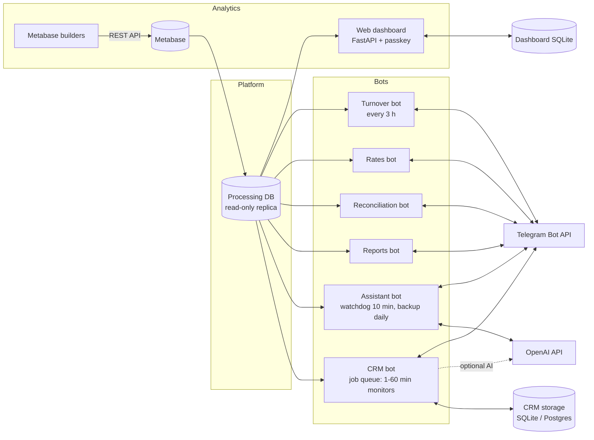

# Merchant Ops Bots

Merchant Ops Bots - Telegram bots and analytics for a payment business. A set of internal tools for account managers, support and finance at a payment aggregator: merchant CRM with real-time alerts, an AI analyst over the processing database, Excel reports, payment reconciliation, a rate catalog, turnover posts and Metabase dashboards.

All merchant, provider and person names in this repository are synthetic (`Alpha`, `Bravo`, `gate-orion`, ...). The code expects a read-only PostgreSQL replica of a processing platform; it does not ship with data.

## Features

- **CRM bot** - merchant cards, statuses, incidents, plus about 20 background monitors: conversion drops, gate latency, traffic stops, dead requisites, stuck withdrawals, negative margin, spam users, new endpoints, weekly trends.
- **Assistant bot** - private AI analyst: OpenAI tool-calling over the replica (read-only SQL), Excel export, API docs search, voice messages, watchdog and nightly state backups.
- **Reports bot** - Excel exports for a period in three audiences (merchant / provider / internal), with daily breakdown and failure analysis.
- **Reconciliation bot** - support looks up any payment or payout by any ID and gets a full card: status, amounts, route, gate, terminal, requisite, error and attempt timeline.
- **Rates bot** - quick catalog of rates, methods, limits and providers with search.
- **Turnover bot** - posts turnover since 00:00 by currency to a group every 3 hours, plus on-demand `/oborot` and `/hourly`.
- **Web dashboard** - FastAPI app with passkey (WebAuthn) login, bound to localhost and reached through an SSH tunnel: merchant cards, provider catalog, integration tracker.
- **Metabase builders** - scripts that build the main conversion dashboard and a per-gate conversion dashboard through the Metabase API.

## Architecture



How it works:

- Every bot is a standalone process. Each one connects directly to the same read-only replica (`ANALYTICS_DB_URL`) and shares the same SQL model: success = `payment_status_id IN (3,6)`, "issued" = requisite issued or route success, test traffic filtered twice (`is_test` flag plus test merchant names), all time in Moscow time.
- The CRM bot runs its monitors on the `python-telegram-bot` job queue (intervals from 1 minute to 3 hours, plus a weekly trend report on Monday) and posts alerts to group chats. Its own data (merchants, incidents, conversion history) lives in SQLite locally or Postgres when `DATABASE_URL` is set.
- The assistant sends owner questions to OpenAI with tools (`query_replica`, `export_excel`, `search_api_docs`, `draft_forward`); the model writes SQL against a schema described in the system prompt and never invents numbers.
- Access is closed: bots answer only listed admins or an owner ID, others unlock with a master key or a one-time key. The web dashboard listens on `127.0.0.1` only and adds passkey login on top of the SSH tunnel.
- The Metabase builders recreate dashboard cards from code, so SQL for dashboards is versioned here instead of living only in Metabase.

## Components

| Path | One line |
|---|---|
| `bots/crm` | Merchant CRM and real-time alerting bot (largest component, has tests) |
| `bots/assistant` | Private AI analyst for an account manager, OpenAI tool-calling over the replica |
| `bots/reports` | Excel report wizard: entity, audience, period, file |
| `bots/reconciliation` | Payment and payout lookup by any ID for support |
| `bots/rates` | Rates, methods, limits and providers catalog |
| `bots/turnover` | Scheduled turnover posts by currency to a group chat |
| `dashboards/web` | Passkey-protected FastAPI dashboard, localhost only |
| `dashboards/sql` | Metabase dashboard builders (main and per-gate conversion) and a replica helper |

## Scale

Numbers visible from the code in this repository:

- 6 Telegram bots, 1 web dashboard, 2 Metabase dashboard builders.
- About 23,600 lines of Python; the CRM bot alone is about 13,900.
- 20 scheduled jobs in the CRM bot, 28 HTTP routes in the web dashboard.
- 54 unit tests (CRM bot storage and database layer).

## Tech stack

Python 3.11+, python-telegram-bot 20/21 (job queue), psycopg2, SQLite, OpenAI API, openpyxl, matplotlib, FastAPI + uvicorn, WebAuthn (passkeys), itsdangerous, Metabase REST API, GitHub Actions.

## Project structure

```
.
├── bots/
│   ├── crm/             # CRM + alerts: bot.py, handlers/, metabase.py (SQL layer), database.py, tests/
│   ├── assistant/       # AI analyst: brain.py (tools), data.py (SQL), guard.py (backup/watchdog)
│   ├── reports/         # Excel reports: db.py (SQL), builder.py (xlsx), handlers/flow.py (wizard)
│   ├── reconciliation/  # lookup bot: db.py (search by any ID), bot.py (cards)
│   ├── rates/           # rates catalog: rates_db.py, bot.py
│   └── turnover/        # single-file bot on raw Bot API long-polling
├── dashboards/
│   ├── web/             # FastAPI app, passkey auth, replica.py, static/index.html
│   └── sql/             # Metabase builders: main/, gate_conversion/, lib/replica_helper.py
├── .github/workflows/   # CI: CRM bot tests
└── LICENSE
```

## Getting started

The bots need a PostgreSQL replica with the processing platform schema (`pricing_invoice`, `pricing_merchant`, `pricing_product`, `pricing_paymentgate`, ...) and a Telegram bot token. Without them they start but have no data to show. The CRM bot tests run without any external services.

```bash
cd bots/crm                     # or any other component
python3 -m venv .venv && source .venv/bin/activate
pip install -r requirements.txt
cp .env.example .env            # fill in BOT_TOKEN, ANALYTICS_DB_URL, admin ids
python bot.py
```

Web dashboard:

```bash
cd dashboards/web
pip install -r requirements.txt
cp .env.example .env            # ANALYTICS_DB_URL, DASH_SESSION_SECRET=$(openssl rand -hex 32)
python -m uvicorn app:app --host 127.0.0.1 --port 8077
```

Metabase builders read a session cookie from the environment (`MB_COOKIE`) or a local `cookie.txt` (git-ignored); see `dashboards/sql/*/README.md`.

Tests:

```bash
cd bots/crm
pip install -r requirements.txt pytest
python -m pytest
```

## License

MIT, see [LICENSE](LICENSE).
